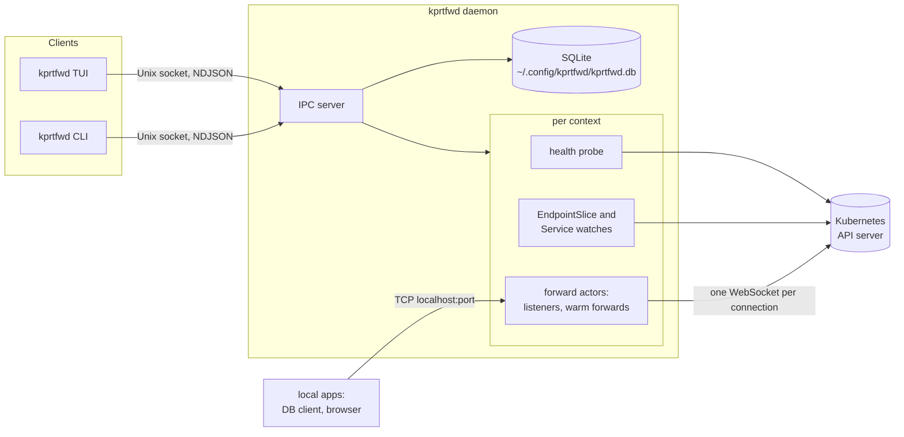

# kprtfwd v2: Rust rewrite architecture

Status: draft, 2026-10-30. Decisions are listed in section 16.

## 1. Summary

kprtfwd v2 is a rewrite in Rust. It splits the tool into a **daemon** that owns
all port-forwards and thin **clients** (a TUI and a CLI) that talk to it over a
Unix socket.

The daemon forwards natively through the Kubernetes API instead of spawning one
`kubectl port-forward` per forward. It uses its own implementation of the
port-forward protocol on top of kube-rs. It tracks reachability once per cluster
context, and it picks a ready pod for every new connection from a watched
EndpointSlice cache. As a result:

- forwards live in the daemon, not in the TUI; by default quitting the TUI
  switches them off as in v1, and one setting keeps them running instead,
- a pod restart only affects connections open at that moment,
- a VPN drop puts the context's forwards into a waiting state, and they recover
  on their own within seconds once the API server is reachable again.

The TUI is one plain list of all forwards across all contexts, built for fast
keyboard use.

The design is backed by a spike, see section 4.

## 2. Why: what v1 runs into

From about 3.5 days of v1 logs on the author's machine (63 forwards, 3 contexts):

| Failure in the log | Count | v1 behaviour | v2 answer |
|---|---|---|---|
| `lost connection to pod` (pod restarted) | 524 | kubectl exits, auto-restart with backoff | pod is picked per connection; the listener never dies |
| `lookup <api-host>: no such host` (VPN down) | 271 | each forward fails on its own, 5 retries in ~60 s, then stays in Error | one health state per context; forwards wait and recover |
| `giving up ... after 5 attempts` | 39 | manual Ctrl+R needed | no retry budget; recovery is driven by observations |
| exec credential plugin failed | 19 | shown as a forward error | context state `AuthFailed` with a hint |

Structural limits of v1:

- Forwards only live as long as the TUI process (`CleanupAll` on exit).
- Status is polled every 2 s; tunnel health is probed by a TCP dial every ~10 s.
- One `kubectl` process per forward; errors are parsed from stderr.
- The UI model is a single struct with 6 view states and 4 mode flags.

## 3. Goals and non-goals

Goals:

- Forwards live in a daemon; whether they outlive the TUI is one setting.
- Pod restarts and short network drops only affect connections open at that moment.
- One place knows whether a cluster is reachable; forwards follow it.
- New-connection latency on par with kubectl or better.
- A TUI for professionals: one list, single keys, the reason for every problem
  visible in the list itself.
- A scriptable CLI (`status --json`, `up`, `down`).
- Existing data is kept: v2 copies the v1 SQLite database to its own directory
  and migrates the copy; IDs stay.
- macOS and Linux.

Non-goals:

- Windows.
- A GUI or menubar app.
- Mouse support, panes, command palette, notifications, or other UI decoration.
- Forwarding to `pod/` or `deploy/` targets; services only, as in v1.
- UDP (Kubernetes port-forward is TCP only).
- A remote or multi-user daemon.

## 4. Evidence from the spike

The spike `v2/spike/kube-forward` (kube 4.2, k8s-openapi 0.28, tokio; about 390
lines; removed in phase 3, it is in the git history) forwarded one service natively, using kube-rs's `Portforwarder`. Results:

| Test | kubectl | Spike |
|---|---|---|
| Auth via `kubectl oidc-login` exec plugin (staging) | works | works |
| Named target ports (`http`, `metrics`) | works | works, via EndpointSlice port names |
| Pod deleted (orbstack, 1 replica) | process exits, every request fails afterwards | 12–15 s gap until the new pod is ready, then continues without a restart |
| Latency per request, staging, sequential `GET /` | 193 ms | 224 ms cold, **87 ms with one warm forward** |
| Pod lookup per connection via API calls | – | ~93 ms; 0 ms from a watch cache |
| Real VPN blip, ~5 s | forward broken, process exits ~45 s later | one failed request, then fine |
| Simulated silent drop, 60 s (frozen TCP proxy) | hangs; after recovery works ~30 s, then hangs | refuses within ~6 s, recovers ~2 s after the network returns |
| Simulated refused connections, 60 s (proxy killed) | `lost connection to pod`, process exits | refuses immediately, recovers ~2 s after the proxy returns |

Lessons that shape this design:

- **One WebSocket per local connection.** The WebSocket port-forward protocol
  carries one data stream per port and connection, so every local connection
  needs its own WebSocket. kubectl's SPDY connection multiplexes streams instead.
  Every new connection therefore pays a TCP + TLS + upgrade handshake (~80–100 ms
  over VPN). Keeping one forward opened ahead of time removes that cost.
- **Pod lookup from a watch cache.** It must not cost API calls per connection.
- **Exec plugins run inside requests.** kube-rs runs exec auth plugins when it
  builds a client and again in every request while the token is expiring, with
  their stderr inherited. A request that times out leaves its plugin running
  while the next request starts another one. With a browser login (kubelogin),
  every attempt opens a tab, even while the API server is unreachable. So the
  daemon runs the plugin itself (section 6.7).
- **Watches can go stale.** kube-rs sets no read timeout by default. A watch whose
  TCP connection is silently dropped is only noticed by the watcher's idle timeout
  (~290 s). The daemon must restart watches when a context recovers.
- **A warm forward can die unnoticed.** kube-rs's `Portforwarder` has no way to
  check whether its connection is still alive. This is the main reason v2 brings
  its own protocol implementation (section 6.4).

## 5. Architecture overview



Process model:

- **One daemon per user, started on demand.** The first client that needs it
  starts it (`kprtfwd daemon run`). There is no launchd or systemd unit.
- **Quitting the TUI.** The TUI registers with the daemon (`Attach`). When the
  last TUI's connection closes, by `q`, a closed terminal or a crash, the daemon
  switches every forward off, lifts a pause and exits. That includes forwards
  switched on with `kprtfwd up`. `keep_forwards_running = true` in
  `config.toml` keeps them running in the background instead.
- **Idle exit.** The daemon exits on its own once no forward has been enabled and
  no client has been connected for 10 minutes. Paused forwards count as enabled.
  A check that cannot read the database counts as busy, logs a warning and is
  tried again 30 s later. `KPRTFWD_IDLE_EXIT_MS` shortens the 10 minutes, for
  tests; the daemon then checks four times per idle time.
- **Clients:** the TUI (`kprtfwd`) and the CLI (`kprtfwd <subcommand>`).
- **The daemon is the only process that writes the database.**
- **One binary.** Everything ships as `kprtfwd`.

Workspace layout:

```
Cargo.toml            workspace
crates/
  core/               domain types, state derivation, store, IDs, service types
  proto/              IPC messages and framing, versioned
  engine/             kube clients, context health, logins, watches,
                      listeners, port-forward protocol
  daemon/             process lifecycle, IPC server, wiring engine <-> store
  tui/                ratatui app
  cli/                clap commands (thin; talk to the daemon)
kprtfwd/              binary: dispatches to tui, cli or daemon
docs/                 this document
```

`core` has no async or Kubernetes dependencies, so the state logic is testable
without a cluster.

Main dependencies:

- runtime and Kubernetes: `tokio`, `kube` (features `ws`, `runtime`), `k8s-openapi`
- storage: `rusqlite` (`bundled`)
- IPC: `serde`, `serde_json`
- logging: `tracing`, `tracing-subscriber`, `tracing-appender`
- CLI and TUI: `clap`, `ratatui`, `crossterm`
- settings: `toml`

## 6. Daemon

### 6.1 Lifecycle

- **Directory.** `~/.config/kprtfwd`, or `$XDG_CONFIG_HOME/kprtfwd`, holds
  `config.toml`, the database, `daemon.sock`, `daemon.pid`, `daemon.lock` and
  `logs/`. The directory has mode 0700 and the socket 0600: whoever can write
  there could replace the socket or plant a database whose forwards run with
  this user's credentials. The daemon refuses a directory that belongs to
  another user, narrows one that others can reach to 0700 (a directory made
  by hand, by a dotfiles manager or under `/tmp`), binds the socket under
  umask 077, and refuses connections of another user (by the peer's uid).
  `KPRTFWD_HOME` replaces the directory, e.g. for tests. Unix socket paths are limited to
  about 100 bytes; the CLI refuses longer ones and names `KPRTFWD_HOME` as the
  way out.
- **Settings.** `config.toml`; the daemon writes a commented template on its
  first start. The only setting is `keep_forwards_running` (default `false`).
  Unknown keys and wrong types are errors: the TUI refuses to start and names
  the file and the problem. The daemon reads the file when the last TUI quits,
  so a change applies without a restart.
- **Moving from `~/.kprtfwd`.** If the directory has no database yet but
  `~/.kprtfwd/kprtfwd.db` exists, the daemon stops a daemon still running there
  (by its PID if it is another version) and copies the database with SQLite's
  backup API. The copy goes to `kprtfwd.db.tmp` and is renamed to `kprtfwd.db`
  once it is complete, so a failed or interrupted copy leaves no database
  behind and the next start tries again; while v1 writes its file, the copy
  waits up to 5 s. `~/.kprtfwd` stays as it is, so v1 keeps working on its own
  copy. With `KPRTFWD_HOME` set, this step is skipped.
- **Start on demand.** A client that finds no daemon runs `kprtfwd daemon run`,
  which starts a session of its own (`setsid`), so no terminal is attached:
  in the session of the terminal its client was started from, an exec plugin
  that reads from `/dev/tty` stopped the whole daemon with SIGTTIN while that
  client ran; now the plugin's read fails at once. The daemon runs in the
  data directory, so it keeps no other directory busy; the client passes
  relative entries of `KUBECONFIG` and a relative `KPRTFWD_HOME` as absolute
  paths. `kprtfwd daemon run` typed into an interactive shell leads its
  process group, cannot start a session and stays in the shell's, where
  ctrl+c ends it. If the daemon exits right away, or fails after binding the
  socket, the client reports it and names the log directory instead of
  waiting or blaming another version; the daemon's stderr goes to
  `logs/daemon.stderr` there.
- **Single instance.** On start the daemon first takes an exclusive lock
  (`flock`) on `daemon.lock` in the directory and holds it until it has
  exited; the system releases it however the process ends. While another
  daemon holds the lock, the new one waits: once the other answers on the
  socket, the new one exits, and once the other has exited, the new one gets
  the lock. It gives up after 10 s, as its client does. Only with the lock
  does it look at the socket: if a handshake succeeds there, a daemon of a
  build without the lock is running and this one exits; if the connection
  fails, the socket is stale, and the daemon removes and rebinds it. So
  clients that start daemons at the same time, also next to a stale socket,
  leave one daemon on the database. The lock file stays in the directory.
- **Start.**
  1. Raise the soft limit of open files to 10240, or to the hard limit if
     that is lower; a higher limit is kept. The daemon inherits the limit of
     the shell that started its client, 256 in a macOS terminal, and every
     forward holds two listeners and every connection two sockets. Exec
     plugins and `lsof` inherit the raised limit.
  2. Open the database and run migrations.
  3. Load forwards and their desired state.
  4. Start a context actor for every context with an enabled forward.
- **Kubeconfig.** The daemon inherits `KUBECONFIG` from the client that started
  it, with relative entries resolved against the client's directory;
  `kprtfwd status` shows which files are in use. The engine merges them in
  one place, for clients, discovery and the hashes below, and skips files that
  do not exist, as kubectl does: a stale entry in `KUBECONFIG` breaks no
  context, and `status` marks it missing. Every 2 s the daemon checks the
  files' modification times and lengths. Tools rewrite the kubeconfig in
  place, so a check can catch it half written, even empty: a change is read
  only once the files looked the same at two checks in a row, and the read
  counts only if they still look the same after it. The files count as read
  only after a read that worked; until then every check reads them again, so
  a fix is not missed where modification times are coarse. After a read it
  hashes, per context, what its client is built from (the names of its
  cluster and user and their entries) and reconnects only the running
  contexts whose hash changed: a renewed token, a moved cluster, a context
  that was missing. They start from that read, so they run exactly what was
  compared. The hash sorts the keys of every map first: kube-rs keeps some
  settings (exec env entries, auth-provider config) in maps whose order
  differs between reads. Switching `current-context`, editing another
  context, or changing a context's default namespace (`kubens`) or extensions
  leaves running forwards alone; forwards carry their own namespace.
  Only the hashes are kept, not the settings, which include credentials. For
  the same reason a kubeconfig that cannot be parsed is reported by line and
  column only, never with the lines around the error.
- **Stop.** `kprtfwd daemon stop`, SIGTERM, the idle exit, or the last TUI
  quitting. The daemon first closes its socket and removes the file, so a
  client from then on finds no daemon and starts the next one, which waits
  for the lock; a connection that arrived just before is reset. Then it
  waits for a request still in progress, closes forwards and the database,
  removes `daemon.pid`, and the lock goes last, with the process. Only the
  last TUI quitting switches the forwards off, and only if no TUI attached
  while the daemon waited for that request. The daemon answers `Shutdown`
  before it exits, and `daemon stop` returns once the socket is gone and
  the lock is free. The socket and `daemon.pid` are removed on every exit
  once the socket is bound, also when the start fails (a failed take-over
  of `~/.kprtfwd`, a database that cannot be opened).
- **Upgrade.** Clients compare versions in the handshake. A daemon of another
  protocol is refused with the hint `kprtfwd daemon restart`. One of another
  version that speaks the same protocol is served, but runs its own code until
  it is restarted, so the TUI's header and every CLI command (on stderr) show
  the same hint. The desired state is persisted, so forwards come back on
  their own. The daemon writes its PID to
  `daemon.pid` as soon as it has bound the socket, so `daemon stop` can end a
  daemon it cannot talk to: one of another protocol by the PID in its
  welcome, one whose answer is no welcome, or that does not answer within
  5 s, by `daemon.pid`.

### 6.2 Context actor

There is one actor per kubeconfig context **that has at least one enabled
forward**. Other contexts stay idle: no client, no probes, no exec plugin calls.
So opening the TUI never triggers a login to a cluster you are not using.

**Building the client.** The actor builds a `kube::Client` from the kubeconfig
context, with kube's default stack and a TCP connector that sets a keepalive
(section 6.4). An exec plugin is taken out of the client's settings first; the
actor runs it itself (section 6.7).

**Health probe.** The probe is `GET /version`, sent with the context's
credentials.

- The endpoint is readable for every authenticated user and returns a few bytes.
  It works in clusters with tight RBAC, where other probes might fail with 403.
- Credentials are still checked: a token the server rejects returns 401. So
  `/version` covers both network and auth problems.
- Without a token it is an anonymous request. Any answer, even 401, shows that
  the API server is reachable, which decides whether the actor may log in.
- The spike used exactly this probe, against staging (k3s 1.33) and orbstack.
- Timeout 3 s. The probe runs every 5 s while healthy and every 2 s while not.
- A healthy context turns unreachable only after two timeouts in a row; a single
  slow answer over VPN is not an outage. DNS and refused connections count at
  once.
- Failures are classified as DNS, refused, timeout, TLS, or auth.

**Watches.** The actor watches EndpointSlices and Services per namespace, only for
namespaces with enabled forwards. The watches are reference-counted and start and
stop as forwards are enabled and disabled.

**On recovery** (unhealthy to healthy):

1. Restart all watches, because a silently dropped watch can stay stale for up to
   ~290 s.
2. Then signal the forwards. A forward whose warm forward the outage took opens a
   new one, to the pod its next connection would use; the cache keeps its objects
   until the watches have listed again, so that is the pod from before the
   outage. A remembered 403 is cleared, so the next port-forward checks it again.

**State.** The actor publishes its `ContextState` through a `tokio::sync::watch`
channel.

### 6.3 Forward actor

There is one actor per enabled forward.

**Listeners.**

- It binds `127.0.0.1` **and** `::1` on the local port. kubectl binds both, and
  clients that resolve `localhost` may try `::1` first. So the port is busy if
  either address is taken, e.g. by a dev server that listens on `::1` only;
  otherwise `localhost` would reach that server while the forward shows
  ready. Only where IPv6 is unavailable (`::1` not configured, or no IPv6 at
  all) does the forward listen on `127.0.0.1` alone; its event says so.
- The listeners stay bound while the forward is enabled, even when the context is
  unreachable. That keeps the port reserved.
- A forward that starts again (an edit, a reconnect, a kubeconfig change)
  starts only once the old one has closed its listeners, so it does not find
  its own port busy.
- While the forward is not ready, incoming connections are closed immediately and
  the reason is recorded as a forward event.

**Per connection:**

1. Pick the pod (see below).
2. Take the warm forward or open a new one.
3. Copy bytes in both directions.
4. Record stats: active connections, bytes, last error.

**Pod choice.** Use the last pod as long as it is ready. Otherwise pick another
ready pod and keep using that one.

- This is what kubectl does.
- It keeps a debugging session on one pod.
- It is safe for apps that keep sessions in memory.

Spreading load across pods is irrelevant for a developer forward. There is no
setting for this.

**Warm forward.** After each connection, one port-forward stream is opened ahead
of time for the next one, and kept for at most 60 s.

- Only for HTTP services (by port and name, as in v1's service types). Browsers
  open many short connections and gain the most. For other protocols an idle
  connection is just noise in the server's logs, and server-first protocols such
  as MySQL would send their greeting into a stream nobody reads yet.
- It is discarded when the pod changes, when the context has an outage, when it
  receives anything before it is used, or after 60 s. One that finishes opening
  while the context is not healthy is not kept. After an outage that took it, it
  is opened again (section 6.2); a 403 for it marks the forward forbidden, as
  one for a connection does.

There is no setting for this either.

**Port busy.** If binding either address fails with `EADDRINUSE`, the state
becomes `PortBusy`, with the owning process if it can be found, and the forward
holds neither address. The actor retries the bind every 5 s. This is local and
cheap, so there is no limit. A port busy at the first attempt is tried again
after 100 ms before it counts as busy: a process the daemon starts just then
(`lsof`, an exec plugin) holds copies of the daemon's sockets until it has
started, so a listener closed meanwhile keeps its port for a moment.

**Out of file descriptors.** If accepting fails because the daemon or the system
has no file descriptor left (`EMFILE`, `ENFILE`), the forward tries again every
second instead of every 100 ms, and reports it once: a warning in the log, the
event `cannot accept connections: too many open files`, and the same text as its
last error, which the INFO column of a ready forward shows while it lasts.
Meanwhile a client that connects waits in the listen queue on Linux; macOS
closes it. The event `accepting connections again` comes with the next
connection accepted.

### 6.4 Port-forward protocol

v2 implements the WebSocket port-forward protocol itself. kube-rs is only used to
open the upgraded connection.

**Upgrade.** `kube::core::Request::portforward(pod, &[port])` builds the request.
`kube::Client::connect` sends it and handles TLS, auth (section 6.7) and
the WebSocket handshake (subprotocol `v4.channel.k8s.io`). Opening a stream times
out after 10 s: over a silently dead network the handshake would otherwise hang
until the health probe notices the outage (about 15 s, two probe timeouts).

**Framing.**

- Binary messages; the first byte is the channel: 0 is data, 1 is the error
  channel for the single port.
- The first message on each channel carries the port number (u16, little endian).
  It is checked.
- Data goes straight between the WebSocket and the local socket. kube-rs puts an
  extra in-memory pipe (up to 1 MB buffered) in between; v2 does without it.
- Both the local socket and the connection to the API server set `TCP_NODELAY`,
  as kubectl's Go sockets do: a small write, such as the second half of a
  request, goes out at once instead of waiting until the last one was
  acknowledged, which over a VPN can take a round trip plus a delayed ACK.

**Error channel.** Text from the kubelet, e.g. "connection refused" inside the pod,
becomes a forward event and shows up in the TUI.

**Liveness.** Every connection runs as a task owned by the forward actor, so the
actor always knows whether it is still alive; disabling the forward ends them all.
So does an outage: once the context is declared unreachable, the open connections
are closed. Their streams go over a connection to the API server that is most
likely dead and might not fail for minutes, or never while neither side sends;
closed, their clients notice and connect again, as with kubectl, which exits when
it loses the API server. A login state does not close them, as an open stream
stays authorized.

Connections to the API server have a TCP keepalive: after 15 s without traffic,
a probe every 5 s, and after 3 unanswered ones the connection fails. So a path
that died while the context stayed healthy, e.g. as the VPN came back with
another address before the probe noticed the outage, ends its streams about 30 s
after their last packet; that is no quicker than an outage is declared. kube's
default connector sets no keepalive and has no hook for one, so the context
builds kube's default client stack with a connector of its own; with a proxy it
leaves the client to kube, which rejects proxies with the features built.

A warm stream waits in a small keeper task that reads from it: a close, an error
or unexpected data ends it. A stream that dies silently is caught by the 60 s
maximum age, the keepalive and the context's health probe. WebSocket pings are
not used.

**Close.** The protocol has no half-close. When either side ends, the WebSocket is
closed, as in kubectl's WebSocket mode and in kube-rs.

**Reference.** kube-rs `src/api/portforward.rs` (under 400 lines) and the spike.

### 6.5 State model

```rust
enum ContextState {
    Idle,                                       // no enabled forwards
    Connecting,
    LoggingIn,                                  // exec plugin running, no accepted token
    Healthy { server_version: String },
    Unreachable { since: SystemTime, cause: NetCause },
    AuthFailed { since: SystemTime, message: String },
    ConfigError { message: String },            // context missing in kubeconfig
}

enum NetCause { Dns, Refused, Timeout, Tls(String), Other(String) }

enum ForwardState {
    Disabled,
    Paused,                                     // global pause, see 6.6
    Starting,                                   // listener or cache not ready yet
    PortBusy { holder: Option<String> },        // "mysqld (pid 812)", via lsof
    WaitingForContext,                          // context is not Healthy
    WaitingForPods { ready: u16, total: u16 },  // no ready endpoint
    Misconfigured { problem: Misconfig },       // service or port missing, RBAC
    Ready { pod: Option<String>, active_conns: u32 },
}

enum Misconfig { ServiceNotFound, PortNotOnService, Forbidden(String) }
```

`ForwardState` is **derived** by a pure function from: enabled, paused, the bind
result, the context state, the endpoint cache and the service cache. There are no
retry counters. Transitions come from observations: probe results, watch events
and bind attempts. The derivation is table-tested in `core`.

| Observation | Forward state |
|---|---|
| forward disabled | `Disabled` |
| global pause on | `Paused` (listeners closed) |
| bind failed | `PortBusy` (retry bind every 5 s) |
| context not `Healthy` | `WaitingForContext` |
| service missing, or port not on service | `Misconfigured` (re-evaluated on Service watch events) |
| port-forward rejected with 403 | `Misconfigured(Forbidden)` (re-evaluated on recovery or a manual reconnect) |
| no ready endpoint | `WaitingForPods` |
| otherwise | `Ready` |

### 6.6 Desired state, projects, pause

- **Enabled flag.** Each forward has a persisted `enabled` flag.
- **Projects.** A project is a named set of forwards. Its status is derived:
  active (all enabled), partial, or inactive.
- **Project actions:**
  - *enable*: adds to what is already running;
  - *disable*: disables its forwards;
  - *switch to*: enables its forwards and disables all others, which is the v1
    behaviour.
- **Pause.** A global `paused` setting is persisted, and is what v1's Ctrl+P does.
  Listeners close, the `enabled` flags stay as they are, and resume restores them.
- **Restarts.** Starting the daemon brings back every enabled forward. When the
  last TUI quits without `keep_forwards_running`, every forward is switched off
  and the pause lifted, so the next start begins with nothing running, as in v1.

### 6.7 Auth plugins

Exec plugins such as `kubectl oidc-login get-token` may log in through the
browser. kube-rs would run them inside requests (section 4), so the daemon runs
them itself:

- Only the context actor's health probe starts the plugin, and only while the
  API server answers. While it is unreachable, for example without VPN,
  nothing runs and no browser opens.
- The login runs next to the probe, not inside it, so the probe goes on: a
  VPN drop during a browser login still shows. While the context has no
  token the API server accepts (none yet, or a rejected one), its state is
  `LoggingIn` and its forwards wait with `logging in`; while the old token
  still works, the context stays `Healthy`. Every login is a context event,
  `logging in with <plugin>`.
- Plugins run one at a time across all contexts, discovery and prune
  included, so a browser login opens one tab at a time, and the next plugin
  may find the first one's tokens in its cache. A login that had to wait for
  another one asks the API server again before it runs.
- The probe logs in when there is no token, when it expires within 60 s, or
  when the API server rejects it. A token that the plugin returns with less
  than 60 s left, such as one it hands out from its own cache until it
  expires, is renewed only once it has expired, and one already expired by
  the local clock only when the API server rejects it; otherwise the plugin
  would run on every probe. A layer in the client adds the token to every
  request; watches and port-forwards never run the plugin.
- The watches of a context with an exec plugin start after its first login.
- After a failed login the probe stops, and the context stays `AuthFailed`.
  Another attempt could open yet another browser tab while nobody is there.
  Reconnecting the context (`r`, `kprtfwd reconnect`) tries again; so does a
  change to its kubeconfig settings.
- The plugin runs without a terminal: stdin is `/dev/null`, stderr is read for
  the error, and `KUBERNETES_EXEC_INFO` says `interactive: false`. kubelogin
  ignores that flag and opens the browser anyway, which is why the rules above
  are needed. A login that takes longer than 5 minutes is stopped.
- A login ends when the plugin exits. A browser it started may inherit its
  stdout and stderr and keep them open; the daemon reads them for another
  0.5 s at most, then empties them in the background until the browser
  closes them, so that its writes neither block nor fail.
- Errors name the plugin by its command and first argument, never the other
  arguments: kubeconfigs pass client secrets there. In the plugin's own error
  text every value it was given is masked, whatever its name, and so is
  anything that looks like a token.
- Plugins that return a client certificate instead of a token are not
  supported yet.
- Discovery and prune log in the same way, once per call, in turn with all
  other logins, and only if the API server answers.

### 6.8 Logging and events

- `tracing` writes to `~/.config/kprtfwd/logs/daemon.<date>.log` (daily rotation, 7
  files kept). `kprtfwd daemon run --foreground` logs to the terminal instead.
- Panics are logged as errors, also those in a task, which end only that task.
  A daemon started on demand appends its stderr to `logs/daemon.stderr`:
  errors from before the log is open, and crashes the log cannot hold.
- `KPRTFWD_LOG` sets the filter (`tracing` syntax). By default kube-rs's own
  request logging is off: it logs every failed request as an error, while an
  outage should be reported once, by the context state.
- The engine keeps the last 100 events of each forward and each context; they
  survive switching a forward off and on, but not a daemon restart. The TUI's
  event view (`l`) shows a forward's events merged with its context's;
  `kprtfwd logs <project or words>` does the same for any set of forwards, and
  `kprtfwd logs` without arguments shows the daemon's log file. Both follow
  with `-f`; times are local. Events include:
  - state changes,
  - refused connections and why,
  - pod switches,
  - errors from the error channel,
  - running out of file descriptors and the end of it.

## 7. IPC protocol

- **Transport.** A Unix domain socket.
- **Framing.** Newline-delimited JSON with serde-tagged enums. It is easy to debug:
  `socat - UNIX-CONNECT:$HOME/.config/kprtfwd/daemon.sock`. A message is at
  most 16 MiB; a longer line is skipped up to its newline instead of being
  kept in memory. The daemon answers a line it cannot read, too long or no
  request, with an `Error` that carries the line's `id`, or 0 if it has
  none, and keeps the connection: closing it would count as a TUI quitting.
- **Handshake.** The client sends `Hello { protocol, client_version }`, the daemon
  answers `Welcome { protocol, daemon_version, pid }`. Different protocol numbers
  mean the client asks the user to restart the daemon; so does an answer that is
  no welcome, or a closed connection. Different versions with the same
  protocol are served, with a hint to restart the daemon (section 6.1). The
  daemon does not check `client_version`. A client waits at most 5 s for the
  welcome, except one that has just started the daemon, which waits for the
  start (10 s).
- **Requests.** `{"id": 7, "request": {"type": "set_enabled", ...}}`; the response
  echoes the `id`. The request is nested, not flattened next to `id`, because some
  requests have an `id` field of their own; a test sends every request kind
  through serde to keep it that way.
- **Updates.** Clients ask for a `Snapshot` when they need one; the TUI does so
  every 300 ms. Over a local socket that costs a few milliseconds, and it saves a
  push protocol with sequence numbers. A subscription can come later if polling
  ever shows up in a profile.
- **Slow requests.** `Discover`, `Prune` and `ListContexts` talk to a cluster or
  read the kubeconfig without holding the daemon's lock, so snapshots keep
  flowing while they run.

```rust
enum Request {
    Hello { protocol: u32, client_version: String },
    Attach,               // sent by the TUI (section 5)
    Snapshot,
    SetEnabled { ids: Vec<ForwardId>, enabled: bool },
    SetProjectEnabled { name: String, enabled: bool },
    SwitchProject { name: String },
    SetPaused { paused: bool },
    ReconnectContext { name: String },
    UpsertForwards { forwards: Vec<Forward> },
    DeleteForward { id: ForwardId },
    UpsertProject { project: Project },
    DeleteProject { name: String },
    ListContexts,
    Discover { context: String, namespace_filter: String },
    Prune { context: String, namespace_filter: String, delete: Option<Vec<ForwardId>> },
    Events { ids: Vec<ForwardId> },
    Shutdown,
}

enum Response {
    Welcome { protocol: u32, daemon_version: String, pid: u32 },
    Snapshot(Snapshot),   // contexts, forwards with state, projects, paused
    Done,
    Contexts { names: Vec<String>, current: Option<String> },
    Discovered { ports: Vec<DiscoveredPort>, skipped: Vec<String> },   // with proposed ID and local port
    Pruned { forwards: Vec<Forward>, skipped: Vec<String> },
    Events { entries: Vec<EventEntry> },
}
```

`SetEnabled` takes a list, so the TUI can switch every forward in its current list
on or off with one request (`+` / `-`).

`Prune` without `delete` only lists the forwards whose service is gone. The
confirmed call sends the IDs the user was shown, and the daemon deletes those
of them that are still gone after listing the cluster again: a forward that
was not shown is never deleted, and one whose service came back while the
prompt waited is kept. `skipped` in both answers names the namespaces whose
services the user may not list (section 9).

## 8. Persistence and migration

- **Database.** `~/.config/kprtfwd/kprtfwd.db`, copied from v1's
  `~/.kprtfwd/kprtfwd.db` on the first start (section 6.1). It uses `rusqlite`
  with `PRAGMA foreign_keys = ON` and WAL mode.
- **Schema version.** The version lives in `PRAGMA user_version`. A database that
  has the v1 tables and `user_version = 0` counts as version 1. Migrations are
  additive:
  - **v2:** `port_forwards` gains `enabled INTEGER NOT NULL DEFAULT 0`. A new
    table `settings (key TEXT PRIMARY KEY, value TEXT)` holds `paused`.
    Project memberships whose forward or project is gone are deleted: v1
    never enables foreign keys, so its files can hold them.
- **Backup.** The first migration copies the database to `kprtfwd.db.v1-backup`,
  through a temporary file like the take-over. If the copy fails, the database
  is not migrated, and the next start tries both again.
- **Rollback.** v1 keeps its own file in `~/.kprtfwd`, which v2 no longer
  changes; that is the rollback path, without the changes made in v2. v1 also
  works on a migrated database, because it always reads and writes explicit
  column lists and the schema changes are additive; a project member it writes
  for a deleted forward is ignored by v2. v1 and v2 should not run at the same
  time, because they would compete for local ports.
- **IDs.** IDs are opaque and kept as they are. The current database holds two
  historic shapes: 21 IDs with three parts and 42 with four. New IDs are
  `<context>.<namespace>.<service>-<port>`, sanitized as in v1, with a numeric
  suffix on collision.

## 9. Discovery

- **Where it runs.** In the daemon, which already has the clients, the auth and
  the logging. It is exposed via IPC, and the TUI renders it.
- **Contexts** come straight from the kubeconfig (no `kubectl config get-contexts`).
- **Listing services.** A filter without wildcards names one namespace, and only
  that namespace is listed. Otherwise the daemon first lists services
  cluster-wide. If that is forbidden, it lists the namespaces and then the
  services of those that match the filter, eight namespaces at a time. If
  listing namespaces is forbidden too, the user is asked for an exact namespace
  name. Every list is read in pages of 500 objects, each page with a time limit
  of 30 s, so a large cluster does not run into one limit for everything.
- **Namespaces the user may not read.** Rights are often granted per
  namespace. In the fallback, a namespace whose services the user may not list
  (403) is skipped and named in the answer; the TUI and `kprtfwd prune` show
  these names. Any other failure in a namespace fails the whole listing, and a
  forbidden namespace asked for by its exact name is an error.
- **Proposed local port.** v1 proposes the remote port; 53 of the 63 local ports in
  use are 10000 or higher, so they were changed by hand. v2 proposes, in order:
  1. the existing local port, if the forward already exists;
  2. otherwise the remote port, if it is 1024 or higher and free;
  3. otherwise `10000 + remote`, if that is valid and free;
  4. otherwise the next free port.

  Free means that nothing listens on the port on `127.0.0.1` or on `::1`, as
  a forward needs both (section 6.3).
- **Conflicts** with existing forwards and with ports in use are marked.
- **Service types.** The classification is ported from `pkg/svctype` (mysql, redis,
  http, ...). It decides when "open in browser" applies.
- **Prune** uses the same listing to remove forwards whose service no longer exists.
  A forward in a skipped namespace is unknown, not gone: prune neither lists
  nor deletes it.

## 10. TUI

Principles:

- **One list of all forwards, across all contexts, always.** The context is a
  column, not something you select. There are no panes and no focus switching.
- **The filter searches everything at once.** Words are matched against context,
  namespace, service, port and ID, and all words must match. So `stag mysql`
  shows the MySQL forwards in staging. The list updates on every keystroke.
- **Act on what you see.**
  - `space` switches the selected forward on or off.
  - `+` / `-` switch all listed forwards on or off.
  - Filter, then `+`, is the fast way to bring up a group.
- **The reason is in the list.** Every forward that is not ready says why in its
  INFO column. There is no detail pane.
- **One key per action.** Nothing asks for confirmation except deleting a forward.
- **Nothing fancy.** No mouse, no command palette, no notifications, no Unicode
  symbols. Colour is only used in the STATE column.

Layout:

```
 staging ok 11/12 · production unreachable (DNS) · orbstack idle             kprtfwd 2.0.0
 / shop
 STATE    CONTEXT     SERVICE                  LOCAL  INFO
 waiting  production  shop/frontend:80         28090  API unreachable (DNS)
 ready    staging     shop/frontend:80         18090
 ready    staging     shop/api:80              18091
 waiting  staging     shop/cart-api:80         18093  0/1 pods ready
 error    staging     shop/checkout:80         18094  port busy: node (pid 4121)
 off      staging     shop/admin:80            18095
 space on/off · / filter · +/- all listed · p projects · o open · y copy · ? keys
```

- **Header line:** the state of every context with enabled forwards; idle contexts
  are listed last. On the right, this kprtfwd's version; a daemon of another
  version that speaks the same protocol adds `daemon <version>: kprtfwd daemon
  restart`, in yellow.
- **A lost daemon** replaces the header with `lost the daemon: <reason>;
  reconnecting` in red, on as many lines as the reason needs; for a daemon of
  another version it ends with the hint `kprtfwd daemon restart`. The reason
  is the latest one: why the connection broke, then why connecting again
  failed. The list stays, all in grey, since its states are the last known
  ones. The first snapshot after a reconnect ends this and clears the message
  line.
- **Order:** the list is sorted by context, namespace, service and port. The order
  stays fixed, so positions are predictable. A long list scrolls only when the
  cursor leaves the page, and when the selected forward goes away (deleted, or
  gone from the database), the cursor moves to its neighbour.
- **STATE values:** `ready`, `waiting`, `error`, `paused`, `off`.

Keys:

| Key | Action |
|---|---|
| `↑ ↓` / `j k`, `PgUp PgDn`, `g G` | move, page, top, bottom |
| `space` | selected forward on or off |
| `/` | filter; `enter` keeps it, `esc` clears it |
| `+` / `-` | all listed forwards on / off |
| `p` | projects (see below) |
| `o` | open `http://localhost:<port>` |
| `y` | copy `localhost:<port>`, with `pbcopy`, or the first of `wl-copy`, `xclip` and `xsel` that works |
| `e` / `a` / `x` | edit, add, delete a forward |
| `d` | discover services |
| `P` | pause or resume all |
| `r` | reconnect the selected forward's context |
| `l` | events of the selected forward, the newest at the bottom; `j k`, `PgUp PgDn`, `g G` scroll back |
| `?` | key help |
| `ctrl+l` | redraw the screen |
| `q`, `ctrl+c` | quit and switch all forwards off; with `keep_forwards_running` they keep running |

A key with `ctrl` or `alt` does nothing unless it is named here, so `ctrl+q`
does not quit and `ctrl+y` does not confirm a delete. In text inputs (the
filter, the forms, a project's name) `backspace` or `ctrl+h` deletes a
character, `ctrl+w` a word and `ctrl+u` the whole input.

**Projects are made from the list.** Filter until the list shows what belongs
together, then `p`:

| Key in `p` | Action |
|---|---|
| `enter` / `-` | switch the project on / off |
| `s` | switch to the project: its forwards on, all others off (v1's behaviour) |
| `f` | show its members: sets the filter to `@name` |
| `n` | new project from the listed forwards |
| `u` | set the project's members to the listed forwards |
| `x` | delete the project (asks; its forwards stay) |

`@name` works in every filter, also in `kprtfwd up @shop`.

There is no grouping and no collapsing. v1 grouped by context or service type;
with the context as a column and a filter over everything, groups only add keys.

The forms are plain line-based dialogs, with `tab` to move between fields, `enter`
to save and `esc` to cancel. They are:

- **Edit/add:** context, namespace, service, remote port, local port.
- **Discovery:**
  1. choose a context (the current one is preselected);
  2. enter a namespace filter (`*` wildcards, empty for all);
  3. a service list with a filter; `space` marks, `+`/`-` mark all listed, `e`
     edits the proposed local port, `enter` adds the marked services (switched
     off). Ports that already have a forward show as `added`. Namespaces
     skipped because their services may not be listed are named below the list.

  While discovery lists the cluster, `esc` goes back to the list, which stays
  usable. Each discovery has a number, and only the answer with the number
  the TUI waits for is shown: the late answer of a discovery left with `esc`
  is dropped, also when another discovery has started meanwhile.

Internal structure:

- **Elm-style.** `App` holds the latest daemon snapshot plus local UI state.
  `App::update(Msg) -> Vec<Cmd>` handles keys and results without a terminal;
  `view::draw(&App, &mut Frame)` draws.
- **Modes.** A `Mode` enum replaces v1's flags: `List`, `Filter`, `Projects`,
  `Form`, `Discovery`, `Events`, `Confirm`, `Help`.
- **Daemon calls** are commands; their results come back as messages. They run
  one at a time on the TUI's connection, next to the keys, so a slow or lost
  daemon never holds up the keys: a snapshot or a request may take 5 s,
  connecting (a daemon start included) 15 s. A call that takes longer, or a
  broken connection, means the daemon is lost: commands fail at once, and the
  TUI connects again at once and then every second. The old connection stays
  open until the new one has attached, so the daemon never takes the TUI for
  gone and switches the forwards off. Discovery runs on a connection and in a
  task of its own, for at most 6 minutes (a browser login may take 5).
- **Signals.** SIGTERM and SIGINT end the TUI like `q`, so the terminal is
  restored; in raw mode ctrl+c is a key.
- **Tests:** `App::update` is tested key by key; the drawing with ratatui's
  `TestBackend`. The flows were also driven end to end with `expect` against
  orbstack (ratatui only redraws changed cells, so such scripts match single
  words and press `ctrl+l` before each check).

## 11. CLI

| Command | Purpose |
|---|---|
| `kprtfwd` | TUI; starts the daemon if needed |
| `kprtfwd status [--all] [--json]` | contexts and enabled forwards (with `--all` every forward) with their state; `--json` in the format below |
| `kprtfwd up <project or words>...` / `down ...` | enable or disable a project, or every forward the words match (as in the TUI filter); `down --all` disables all. Both need words, and an empty word, as an unset variable in a script gives, is wrong usage: it would match every forward |
| `kprtfwd switch <project>` | enable the project, disable everything else |
| `kprtfwd pause` / `resume` | global pause |
| `kprtfwd prune [--context C] [--namespace 'app-*'] [-y]` | as in v1: lists forwards whose service is gone and deletes them after asking; only the listed forwards are deleted, and nothing if the cluster cannot be listed. Forwards in namespaces whose services the user may not list are left alone, and those namespaces are named. The list names the context, which defaults to the daemon's current context (its kubeconfig may differ from the shell's) |
| `kprtfwd logs [-f] [project or words]` | events of the matching forwards and their contexts; without arguments the daemon log |
| `kprtfwd discover ...` | not built; the TUI's `d` covers it |
| `kprtfwd reconnect <context>` | rebuild a context's client, watches and forwards |
| `kprtfwd daemon status/stop/restart` | daemon control (`daemon run [--foreground]` is internal, or for debugging) |
| `kprtfwd db list [--db PATH]` | read the database without the daemon; the file is not changed |

`status --json` is the CLI's interface for scripts and is documented in the
README. It is not the IPC snapshot, whose shape changes with the protocol: an
object with `version` (1; bumped when a field is removed or changes its
meaning, not for a new field), `paused`, `contexts` (`name`, and `state` as
in the header line) and `forwards`, the rows of the table (`id`, `context`,
`namespace`, `service`, `remote_port`, `local_port`, `enabled`, and `state`
and `info` as in the STATE and INFO columns). It holds no times. A golden
test pins it.

Exit codes:

- 0: ok
- 1: error
- 2: wrong usage (clap's code: an unknown flag, a missing argument)
- 3: `status` only; some enabled forwards are not ready
- 4: daemon not reachable: not running and it could not be started, it does
  not answer, or the connection failed or closed during the command. A
  daemon of another protocol answers and gets 1; its message says to
  restart it.

## 12. Error messages

These are shown in the INFO column and by `kprtfwd status`.

| Cause | Message |
|---|---|
| DNS lookup of the API host fails | `API unreachable (DNS)`; header: `staging unreachable (DNS, VPN?)` |
| refused or timed out | `API unreachable (timeout)` |
| exec plugin logging in, no accepted token yet | `logging in` |
| login failed or rejected (401) | `login needed: reconnect (r) to log in` |
| 403 on watch or port-forward | `forbidden: port-forward in namespace X` |
| `EADDRINUSE` | `port busy: mysqld (pid 812)` |
| service gone | `service not found (prune?)` |
| no ready endpoints | `0/2 pods ready` |
| error channel message | the kubelet's text, e.g. `pod refused connection on 3000` |

## 13. Testing

- **core:** table tests for state derivation, ID generation, and service type
  classification (the v1 tests are ported). Migration tests run on a v1 fixture
  database.
- **engine:**
  - unit tests for the protocol framing (encode, decode, port header, error
    channel);
  - login tests with a fake exec plugin and API server: no login while the API
    server is unreachable, one login once it answers, none after a failed or
    rejected login, no secrets in the error, a login that ends when the
    plugin exits although a process it left behind holds its output, no
    login on every probe for a token that keeps its expiry, two contexts that
    log in one after the other, a login that waited for its turn and finds
    the API server gone, and a login next to the probe: an outage meanwhile
    shows, and a renewal keeps the context healthy until the API server
    rejects the old token. They probe ten times faster than in use;
  - unit tests with a fake API server on a local port (`fake.rs`): the probe's
    state machine with a given time and the rule for restarting watches; the
    client's own stack, which sends the kubeconfig's token and impersonation on
    requests and port-forwards and leaves a proxy to kube;
    `Engine::reconcile` and `reconnect` with a kubeconfig of their own, never
    `~/.kube/config`, and a forward they start again on its port, which
    binds it at the first attempt; a closed forward frees its port at once;
    kubeconfig fingerprints (maps read in any order, the
    default namespace), merging with missing files, and the watcher on
    files in a temporary directory (a change read only once settled, a
    truncated or half-written file never used, a failed read tried again with
    the same time and length, a file that appears); discovery and its
    per-namespace fallback; the error classification with the errors kube-rs,
    hyper-util and rustls really return;
  - the watch cache's lookup over hand-built Services and EndpointSlices
    (several slices, dual stack, unknown readiness, named target ports), and
    the forward actor through a fake kubelet: pod choice and the move to
    another pod, connections closed at once while not ready, open connections
    closed once the context is unreachable but not while it logs in, a refused
    port-forward and its check after an outage, the error channel, warm
    streams and when they are dropped or opened again after an outage, the
    `::1` listener, a port busy on `127.0.0.1` or on `::1` only, and failed
    accepts, where running out of file descriptors is reported once per
    episode and slows the retries down. Tests that close a port and bind it
    again take one below the ephemeral range (`fake::closed_port`), and
    accept a port that a process started by another test holds: macOS sets
    close-on-exec only after creating a socket, so such a process may
    inherit a socket of the test (`fake::held_by_another_process`);
  - cluster tests in `crates/engine/tests/cluster.rs`, run in CI against kind
    (job `cluster`) and locally against any throwaway cluster. They only run
    when `KPRTFWD_TEST_CONTEXT` is set; each creates and deletes its own
    namespace:
    - the forward stays on one pod, also for requests to `::1`; deleting that
      pod moves it to the other one by itself (at most 3 failed requests
      allowed, 0 seen), and the events say so;
    - scaled to 0, connections close at once and the state is
      `WaitingForPods`; scaled up, it works again without a restart;
    - with `KPRTFWD_TEST_PAUSE`/`RESUME` (`docker pause` of the kind control
      plane): the outage is detected (about 15 s; the test allows 25 s), a
      connection open since before the outage is closed with the detection,
      new connections close at once meanwhile, and the forward is ready again
      about 2 s after the resume (the test allows 10 s). A failing test still
      resumes the control plane.
- **proto:** serde round trips and the protocol version check.
- **daemon:** `kprtfwd/tests/daemon.rs` runs the real binary with `HOME` set to
  a temporary directory: quitting the last TUI switches the forwards off and
  lifts the pause, another client or `keep_forwards_running` keeps them, a
  daemon still running in `~/.kprtfwd` is stopped and its database copied, and a
  failed take-over leaves no socket and is tried again on the next start; a
  stale socket is replaced, eight daemons started at once on a stale socket
  leave exactly one, whose PID is in `daemon.pid`, while the others exit with 0;
  a client that connects while the daemon exits after the last TUI quit, here
  waiting for the database the test holds, is told at once that no daemon runs;
  with a 400 ms idle exit the daemon stays while a client is connected and exits
  after it left, and a database it cannot read (a renamed table) keeps it
  running until the table is back; SIGTERM and `daemon stop` (exit code 0)
  remove the socket and `daemon.pid` and leave the forwards on; `daemon stop`
  ends a daemon of another version by the PID in `daemon.pid` (a stand-in: the
  test answers in another protocol, and a shell removes the socket and PID file
  when terminated); and with a fake API server and exec plugin, `use-context`,
  `kubens` and a rewrite of a user with env entries cause no reconnect and no
  login while a moved cluster causes exactly one; `status` shows a context and
  its forward `logging in` while the plugin waits; discovery does not propose a
  port that another process holds on `::1` only; a daemon started with a soft
  limit of 256 open files raises it.
- **cli:** unit tests for the exit code rules, the parsing of `up` and
  `down` and a golden test of the `status --json` format;
  `kprtfwd/tests/cli.rs` runs the binary the same way: exit code 2 for wrong
  usage, without starting a daemon, 4 without a daemon, for one that cannot
  start and for one that closes the connection during a command, 3 while an
  enabled forward is not ready and 0 once it is paused, `status --json` with
  and without `--all`, `up` and `down` by words and with `--all`, `prune`
  against a fake API server (declined, confirmed, `-y`, the daemon's current
  context, a missing file in `KUBECONFIG`), and `logs` with and without `-f`.
- **tui:** key-by-key tests of `App::update`, drawing tests with `TestBackend`
  (also of a lost daemon), tests of the event loop against a fake daemon on
  tokio's paused clock (a lost daemon with its reason and the reconnect, keys
  and ctrl+c while the daemon does not answer, the time limits of requests,
  reconnects and discovery, the new connection attached before the old one
  closes, a request's result and the fresh snapshot, a discovery answer after
  Esc, also while the next discovery waits, ctrl+l and resizes, the events view), and `expect` scripts for the
  whole flow (see section 10).
- **Manual checklist, against every configured context:**
  - forward, auth (including an expired `oidc-login` token) and the health probe;
  - a real VPN drop and recovery;
  - a daemon upgrade while forwards are running.

## 14. Build and distribution

- Release builds via GitHub Actions (`release.yml`, on a `v*` tag) for macOS
  (arm64, x86_64) and Linux (x86_64, arm64, musl, static).
- rustls only, no OpenSSL, so the Linux binaries can be fully static. Each is
  built on a runner of its architecture, with `musl-gcc` for the C parts
  (bundled SQLite, ring); the workflow fails unless `file` and `ldd` show a
  static binary, and runs it.
- A release first checks that the tag is `v` plus the crate version (bump
  `version` in `Cargo.toml` before tagging), then runs all of `ci.yml` on the
  tagged commit; the binaries are built and released only if both pass.
- Pull requests that change `release.yml`, `Cargo.lock` or a `Cargo.toml` build
  all four targets without releasing.
- Every action is pinned to a commit SHA; Dependabot proposes updates.
- The macOS binaries are not signed or notarized; the install steps give the
  `curl` download and the `xattr` command for browser downloads (decided
  2026-11-06).
- Release profile: `strip = true`, `lto = "thin"`.
- The Homebrew tap formula `kprtfwd` switches to the v2 binaries with 2.0.0.

## 15. Delivery plan

| Phase | Scope | Done when |
|---|---|---|
| 0. Setup | workspace in `v2/` on `main`; CI (fmt, clippy, test); store with migration and a v1 fixture; anchor the root `.gitignore` entry `kprtfwd` to `/kprtfwd`, otherwise it also ignores `v2/kprtfwd/` | v2 reads the real database (read-only) and lists forwards |
| 1. Headless daemon and CLI | engine (context actor, watches, own port-forward protocol, warm forward, listeners), IPC, `status`, `up`, `down`, `daemon` | daily use via the CLI works; pod restart and outage tests pass in CI |
| 2. TUI | list, filter, `+`/`-`, projects, pause, edit/add/delete, open/copy, events view, discovery, prune | every v1 feature is covered (parity checklist) |
| 3. Release | move the workspace to the repo root, delete the Go code and `v2/spike`, Homebrew 2.0.0, README | 2.0.0 tagged, after two weeks of daily use without v1 |

The v1 Go code stayed on `main` and kept shipping fixes until phase 3.

Status 2026-10-30: phases 0 to 2 are done, including kubeconfig watching,
`kprtfwd logs` and the cluster tests, which pass locally against kind (twice,
with the same timings). Phase 1 was also run by hand against orbstack and
staging: pod deleted while in use (60 of 60 requests answered), scale to 0 and
back, busy port, missing service, and a TCP proxy to the API server that was
frozen and killed (detected after about 15 s and at once, recovered within a
second; a request during the undetected phase ends after the 10 s open
timeout). Since 2026-11-06, connections that are open when an outage is detected
are closed, including one that took a warm stream in the undetected phase and
so skipped the open timeout.

Phase 2 runs locally: the TUI, CRUD for forwards and projects, discovery, prune
and the event view. Every v1 feature has a counterpart except grouping, which
was dropped on purpose (section 10). Driven end to end with `expect` against
orbstack: empty list, discovery, add, switch on, filter, events, project from
the list, project off, edit the local port, pause and resume; the forward was
then reachable on its new port. `prune` was checked with the service present,
deleted and declined, and deleted and confirmed.

After the first day of daily use, the data moved to `~/.config/kprtfwd` and
quitting the TUI switches the forwards off unless `keep_forwards_running` is
set. The move was checked with the previous build's daemon still running: it was
stopped by its PID and its database copied.

On 2026-10-31 the daemon took over running exec plugins (section 6.7), and
phase 3 began: the Go code and the spike were removed, the workspace moved to
the repository root, and the release workflow builds the Rust binaries. 2.0.0
is not tagged yet, and the Homebrew tap still installs v1.

## 16. Decisions, risks, open questions

Decisions (2026-10-30):

| Topic | Decision |
|---|---|
| Platforms | macOS and Linux; no Windows |
| Repository | the Cargo workspace at the repository root; v1 (Go) is only in the git history |
| Daemon start | on demand by the first client, idle exit after 10 minutes; no launchd/systemd unit |
| Quitting the TUI | switches all forwards off and stops the daemon, as in v1; `keep_forwards_running = true` keeps them running |
| Directory | `~/.config/kprtfwd` (or `$XDG_CONFIG_HOME/kprtfwd`), taken over from `~/.kprtfwd` once |
| Health probe | `GET /version` with credentials (section 6.2) |
| Pod choice | stay on the last ready pod, as kubectl does; not configurable (section 6.3) |
| Port-forward protocol | own implementation on top of kube-rs's upgraded connection (section 6.4) |
| UI | one list across all contexts, filter over everything, single keys, nothing fancy (section 10) |

Risks:

| Risk | Impact | Mitigation |
|---|---|---|
| One WebSocket per connection | +80–100 ms per new connection over VPN | warm forward (measured 87 ms vs kubectl 193 ms) |
| Own protocol implementation misses edge cases | broken or stuck connections | kube-rs and the spike (git history) as reference; framing unit tests; kind tests; manual checks against every configured context |
| A warm stream dies silently | one request after an idle phase fails | keeper task reads the stream; 60 s maximum age; TCP keepalive; dropped on any outage; HTTP services only |
| A watch stays stale after a silent drop | connections go to a pod that is gone | restart watches on recovery; the watcher's idle timeout (~290 s) as a backstop |
| An exec plugin opens a browser tab per attempt | tabs pile up while the API server is unreachable or nobody logs in | the daemon runs the plugin itself: only while the API server answers, one at a time, not again after a failure (section 6.7) |
| Many long-lived connections (watches, warm forwards) | load on the API server | watches only for namespaces with enabled forwards; warm forwards only while healthy |
| Daemon and client versions differ after an upgrade | protocol errors | version check in the handshake, restart offer, persisted desired state |
| v1 and v2 run at the same time | port conflicts | v2 reports the process holding a port |

Open questions: none that block phase 0.
