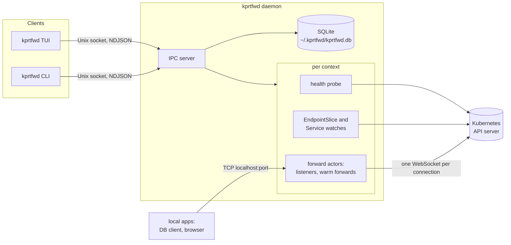

# kprtfwd v2: Rust rewrite architecture

Status: draft, 2026-10-30. Decisions are listed in section 16.

## 1. Summary

kprtfwd v2 is a rewrite in Rust. It splits the tool into a **daemon** that owns
all port-forwards and thin **clients** (a TUI and a CLI) that talk to it over a
Unix socket.

The daemon forwards natively through the Kubernetes API instead of spawning one
`kubectl port-forward` per forward. It uses its own implementation of the
port-forward protocol on top of kube-rs. It tracks reachability once per cluster
context, and it picks a ready pod for every new connection from a watched
EndpointSlice cache. As a result:

- forwards keep running when the TUI or the terminal is closed,
- a pod restart only affects connections open at that moment,
- a VPN drop puts the context's forwards into a waiting state, and they recover
  on their own within seconds once the API server is reachable again.

The TUI is one plain list of all forwards across all contexts, built for fast
keyboard use.

The design is backed by a spike (`v2/spike/kube-forward`), see section 4.

## 2. Why: what v1 runs into

From about 3.5 days of v1 logs on the author's machine (63 forwards, 3 contexts):

| Failure in the log | Count | v1 behaviour | v2 answer |
|---|---|---|---|
| `lost connection to pod` (pod restarted) | 524 | kubectl exits, auto-restart with backoff | pod is picked per connection; the listener never dies |
| `lookup <api-host>: no such host` (VPN down) | 271 | each forward fails on its own, 5 retries in ~60 s, then stays in Error | one health state per context; forwards wait and recover |
| `giving up ... after 5 attempts` | 39 | manual Ctrl+R needed | no retry budget; recovery is driven by observations |
| exec credential plugin failed | 19 | shown as a forward error | context state `AuthFailed` with a hint |

Structural limits of v1:

- Forwards only live as long as the TUI process (`CleanupAll` on exit).
- Status is polled every 2 s; tunnel health is probed by a TCP dial every ~10 s.
- One `kubectl` process per forward; errors are parsed from stderr.
- The UI model is a single struct with 6 view states and 4 mode flags.

## 3. Goals and non-goals

Goals:

- Forwards outlive any UI.
- Pod restarts and short network drops only affect connections open at that moment.
- One place knows whether a cluster is reachable; forwards follow it.
- New-connection latency on par with kubectl or better.
- A TUI for professionals: one list, single keys, the reason for every problem
  visible in the list itself.
- A scriptable CLI (`status --json`, `up`, `down`).
- Existing data is kept: the v1 SQLite database is migrated in place, IDs stay.
- macOS and Linux.

Non-goals:

- Windows.
- A GUI or menubar app.
- Mouse support, panes, command palette, notifications, or other UI decoration.
- Forwarding to `pod/` or `deploy/` targets; services only, as in v1.
- UDP (Kubernetes port-forward is TCP only).
- A remote or multi-user daemon.

## 4. Evidence from the spike

`v2/spike/kube-forward` (kube 4.2, k8s-openapi 0.28, tokio; about 390 lines)
forwards one service natively, using kube-rs's `Portforwarder`. Results:

| Test | kubectl | Spike |
|---|---|---|
| Auth via `kubectl oidc-login` exec plugin (staging) | works | works |
| Named target ports (`http`, `metrics`) | works | works, via EndpointSlice port names |
| Pod deleted (orbstack, 1 replica) | process exits, every request fails afterwards | 12–15 s gap until the new pod is ready, then continues without a restart |
| Latency per request, staging, sequential `GET /` | 193 ms | 224 ms cold, **87 ms with one warm forward** |
| Pod lookup per connection via API calls | – | ~93 ms; 0 ms from a watch cache |
| Real VPN blip, ~5 s | forward broken, process exits ~45 s later | one failed request, then fine |
| Simulated silent drop, 60 s (frozen TCP proxy) | hangs; after recovery works ~30 s, then hangs | refuses within ~6 s, recovers ~2 s after the network returns |
| Simulated refused connections, 60 s (proxy killed) | `lost connection to pod`, process exits | refuses immediately, recovers ~2 s after the proxy returns |

Lessons that shape this design:

- **One WebSocket per local connection.** The WebSocket port-forward protocol
  carries one data stream per port and connection, so every local connection
  needs its own WebSocket. kubectl's SPDY connection multiplexes streams instead.
  Every new connection therefore pays a TCP + TLS + upgrade handshake (~80–100 ms
  over VPN). Keeping one forward opened ahead of time removes that cost.
- **Pod lookup from a watch cache.** It must not cost API calls per connection.
- **Exec plugins print to the terminal.** kube-rs runs exec auth plugins
  synchronously and inherits their stderr, which would corrupt a TUI. That is one
  more reason to keep Kubernetes access in the daemon.
- **Watches can go stale.** kube-rs sets no read timeout by default. A watch whose
  TCP connection is silently dropped is only noticed by the watcher's idle timeout
  (~290 s). The daemon must restart watches when a context recovers.
- **A warm forward can die unnoticed.** kube-rs's `Portforwarder` has no way to
  check whether its connection is still alive. This is the main reason v2 brings
  its own protocol implementation (section 6.4).

## 5. Architecture overview



Process model:

- **One daemon per user, started on demand.** The first client that needs it
  starts it (`kprtfwd daemon run --detach`). There is no launchd or systemd unit.
- **Idle exit.** The daemon exits on its own once no forward has been enabled and
  no client has been connected for 10 minutes. Paused forwards count as enabled.
- **Clients:** the TUI (`kprtfwd`) and the CLI (`kprtfwd <subcommand>`).
- **The daemon is the only process that writes the database.**
- **One binary.** Everything ships as `kprtfwd`.

Workspace layout:

```
v2/
  Cargo.toml          workspace
  crates/
    core/             domain types, state derivation, store, IDs, service types
    proto/            IPC messages and framing, versioned
    engine/           kube clients, context health, watches, listeners,
                      port-forward protocol
    daemon/           process lifecycle, IPC server, wiring engine <-> store
    tui/              ratatui app
    cli/              clap commands (thin; talk to the daemon)
  kprtfwd/            binary: dispatches to tui, cli or daemon
  docs/               this document
  spike/              the spike; removed once the engine replaces it
```

`core` has no async or Kubernetes dependencies, so the state logic is testable
without a cluster.

Main dependencies:

- runtime and Kubernetes: `tokio`, `kube` (features `ws`, `runtime`), `k8s-openapi`
- storage: `rusqlite` (`bundled`)
- IPC: `serde`, `serde_json`
- logging: `tracing`, `tracing-subscriber`, `tracing-appender`
- CLI and TUI: `clap`, `ratatui`, `crossterm`
- kubeconfig changes: `notify`
- browser: `open`
- tests: `insta`

## 6. Daemon

### 6.1 Lifecycle

- **Socket.** `~/.kprtfwd/daemon.sock`; the directory has mode 0700 and the
  socket 0600.
- **Single instance.** On start the daemon binds the socket. If the socket exists
  and a handshake succeeds, another daemon is running and this one exits. If the
  connection fails, the socket is stale; the daemon removes and rebinds it.
- **Start.**
  1. Open the database and run migrations.
  2. Load forwards and their desired state.
  3. Start a context actor for every context with an enabled forward.
- **Kubeconfig.** The daemon inherits `KUBECONFIG` from the client that started
  it. It watches those files and reloads changed contexts. `kprtfwd status` shows
  which files are in use.
- **Stop.** `kprtfwd daemon stop`, SIGTERM, or the idle exit: close listeners,
  close forwards, close the database.
- **Upgrade.** Clients compare versions in the handshake. On a mismatch the TUI
  offers to restart the daemon. The desired state is persisted, so forwards come
  back on their own.

### 6.2 Context actor

There is one actor per kubeconfig context **that has at least one enabled
forward**. Other contexts stay idle: no client, no probes, no exec plugin calls.
So opening the TUI never triggers a login to a cluster you are not using.

**Building the client.** The actor builds a `kube::Client` from the kubeconfig
context.

**Health probe.** The probe is `GET /version`, sent with the context's
credentials.

- The endpoint is readable for every authenticated user and returns a few bytes.
  It works in clusters with tight RBAC, where other probes might fail with 403.
- Credentials are still checked:
  - an exec plugin that fails (expired login) fails the request before it is sent;
  - a token the server rejects returns 401.
  
  So `/version` covers both network and auth problems.
- The spike used exactly this probe, against staging (k3s 1.33) and orbstack.
- Timeout 3 s. The probe runs every 5 s while healthy and every 2 s while not.
- Failures are classified as DNS, refused, timeout, TLS, or auth.
- Auth errors that watches or port-forwards report (401) also set the context to
  `AuthFailed`.

**Watches.** The actor watches EndpointSlices and Services per namespace, only for
namespaces with enabled forwards. The watches are reference-counted and start and
stop as forwards are enabled and disabled.

**On recovery** (unhealthy to healthy):

1. Restart all watches, because a silently dropped watch can stay stale for up to
   ~290 s.
2. Then signal the forwards to open new warm forwards.

**State.** The actor publishes its `ContextState` through a `tokio::sync::watch`
channel.

### 6.3 Forward actor

There is one actor per enabled forward.

**Listeners.**

- It binds `127.0.0.1` **and** `::1` on the local port. kubectl binds both, and
  clients that resolve `localhost` may try `::1` first.
- The listeners stay bound while the forward is enabled, even when the context is
  unreachable. That keeps the port reserved.
- While the forward is not ready, incoming connections are closed immediately and
  the reason is recorded as a forward event.

**Per connection:**

1. Pick the pod (see below).
2. Take the warm forward or open a new one.
3. Copy bytes in both directions.
4. Record stats: active connections, bytes, last error.

**Pod choice.** Use the last pod as long as it is ready. Otherwise pick another
ready pod and keep using that one.

- This is what kubectl does.
- It keeps a debugging session on one pod.
- It is safe for apps that keep sessions in memory.

Spreading load across pods is irrelevant for a developer forward. There is no
setting for this.

**Warm forward.** Exactly one port-forward connection is kept open ahead of time.

- Only while the context is healthy and its pod is ready.
- It is discarded when the pod changes, when the context has an outage, or when
  its liveness check fails (section 6.4).

There is no setting for this either.

**Port busy.** If binding fails with `EADDRINUSE`, the state becomes `PortBusy`,
with the owning process if it can be found. The actor retries the bind every 5 s.
This is local and cheap, so there is no limit.

### 6.4 Port-forward protocol

v2 implements the WebSocket port-forward protocol itself. kube-rs is only used to
open the upgraded connection.

**Upgrade.** `kube::core::Request::portforward(pod, &[port])` builds the request.
`kube::Client::connect` sends it and handles TLS, auth (including exec plugins) and
the WebSocket handshake (subprotocol `v4.channel.k8s.io`).

**Framing.**

- Binary messages; the first byte is the channel: 0 is data, 1 is the error
  channel for the single port.
- The first message on each channel carries the port number (u16, little endian).
  It is checked.
- Data goes straight between the WebSocket and the local socket. kube-rs puts an
  extra in-memory pipe (up to 1 MB buffered) in between; v2 does without it.

**Error channel.** Text from the kubelet, e.g. "connection refused" inside the pod,
becomes a forward event and shows up in the TUI.

**Liveness.** Every connection runs as a task owned by the forward actor, so the
actor always knows whether it is still alive. The warm forward sends a WebSocket
ping every 15 s and is dropped if no pong comes back within 5 s. The API server's
answer to pings on port-forward connections still needs checking in phase 1. If
it does not answer, a maximum age of 60 s is the fallback, as in the spike.

**Close.** The protocol has no half-close. When either side ends, the WebSocket is
closed, as in kubectl's WebSocket mode and in kube-rs.

**Reference.** kube-rs `src/api/portforward.rs` (under 400 lines) and the spike.

### 6.5 State model

```rust
enum ContextState {
    Idle,                                       // no enabled forwards
    Connecting,
    Healthy { server_version: String, rtt: Duration },
    Unreachable { since: SystemTime, cause: NetCause },
    AuthFailed { since: SystemTime, message: String },
}

enum NetCause { Dns, Refused, Timeout, Tls(String), Other(String) }

enum ForwardState {
    Disabled,
    Paused,                                     // global pause, see 6.6
    PortBusy { holder: Option<ProcessInfo> },
    WaitingForContext,                          // context is not Healthy
    WaitingForPods { ready: u16, total: u16 },  // no ready endpoint
    Misconfigured(Misconfig),                   // service or port missing, RBAC
    Ready { pod: String, active_conns: u32 },
}

enum Misconfig { ServiceNotFound, PortNotOnService, Forbidden(String) }
```

`ForwardState` is **derived** by a pure function from: enabled, paused, the bind
result, the context state, the endpoint cache and the service cache. There are no
retry counters. Transitions come from observations: probe results, watch events
and bind attempts. The derivation is table-tested in `core`.

| Observation | Forward state |
|---|---|
| forward disabled | `Disabled` |
| global pause on | `Paused` (listeners closed) |
| bind failed | `PortBusy` (retry bind every 5 s) |
| context not `Healthy` | `WaitingForContext` |
| service missing, or port not on service | `Misconfigured` (re-evaluated on Service watch events) |
| port-forward rejected with 403 | `Misconfigured(Forbidden)` (re-evaluated on recovery or a manual reconnect) |
| no ready endpoint | `WaitingForPods` |
| otherwise | `Ready` |

### 6.6 Desired state, projects, pause

- **Enabled flag.** Each forward has a persisted `enabled` flag.
- **Projects.** A project is a named set of forwards. Its status is derived:
  active (all enabled), partial, or inactive.
- **Project actions:**
  - *enable*: adds to what is already running;
  - *disable*: disables its forwards;
  - *switch to*: enables its forwards and disables all others, which is the v1
    behaviour.
- **Pause.** A global `paused` setting is persisted, and is what v1's Ctrl+P does.
  Listeners close, the `enabled` flags stay as they are, and resume restores them.
- **Restarts.** Starting the daemon brings back every enabled forward.

### 6.7 Auth plugins

kube-rs runs exec plugins such as `kubectl oidc-login get-token` synchronously,
with stderr inherited. In the daemon, stdin is `/dev/null` and stderr goes to the
log. That has three consequences:

- The TUI is never disturbed by plugin output.
- Browser-based logins still work, because the plugin opens the browser itself.
- Plugins that need a TTY fail. The context then shows `AuthFailed` with the hint:
  run `kubectl --context <name> get ns` once to log in.

The plugin call blocks one runtime worker while it runs. The daemon therefore uses
the multi-thread runtime.

### 6.8 Logging and events

- `tracing` writes to `~/.kprtfwd/logs/daemon.log` (daily rotation, 7 files kept).
- Noise from kube and hyper is filtered (`kube=warn`). An outage is reported once,
  by the context state.
- Each forward and each context keeps a ring buffer of its last 200 events. The
  TUI's event view (`l`) and `kprtfwd logs` show them. Events include:
  - state changes,
  - refused connections and why,
  - pod switches,
  - errors from the error channel.

## 7. IPC protocol

- **Transport.** A Unix domain socket.
- **Framing.** Newline-delimited JSON with serde-tagged enums. It is easy to debug:
  `socat - UNIX-CONNECT:$HOME/.kprtfwd/daemon.sock`.
- **Handshake.** The client sends `Hello { protocol, client_version }`, the daemon
  answers `Welcome { protocol, daemon_version }`. Different protocol numbers mean
  the client asks the user to restart the daemon.
- **Requests.** Every request carries an `id`, and the response echoes it.
- **Events.** On a subscribed connection the daemon first sends a `Snapshot`, then
  events with an increasing `seq`. A client that sees a gap in `seq` asks for a new
  snapshot.
- **Stats.** Updates are coalesced to at most 2 per second.

```rust
enum Request {
    Snapshot,
    Subscribe,
    SetEnabled { ids: Vec<ForwardId>, enabled: bool },
    EnableProject { name: String },
    DisableProject { name: String },
    SwitchProject { name: String },
    SetPaused { paused: bool },
    UpsertForward(ForwardSpec),
    DeleteForward { id: ForwardId },
    UpsertProject { name: String, forwards: Vec<ForwardId> },
    DeleteProject { name: String },
    ReconnectContext { name: String },
    ListContexts,
    Discover { context: String, namespace_filter: String },
    Prune { context: String, namespace_filter: String, dry_run: bool },
    Events { scope: Scope, limit: u32 },
    Shutdown,
}

enum Event {
    Snapshot { seq: u64, contexts: Vec<ContextView>, forwards: Vec<ForwardView>, projects: Vec<ProjectView> },
    ContextChanged { seq: u64, context: ContextView },
    ForwardChanged { seq: u64, forward: ForwardView },
    ProjectsChanged { seq: u64, projects: Vec<ProjectView> },
    Log { seq: u64, scope: Scope, entry: EventEntry },
}
```

`SetEnabled` takes a list, so the TUI can switch every forward in its current list
on or off with one request (`+` / `-`).

## 8. Persistence and migration

- **Database.** v2 keeps `~/.kprtfwd/kprtfwd.db`. It uses `rusqlite` with
  `PRAGMA foreign_keys = ON` and WAL mode.
- **Schema version.** The version lives in `PRAGMA user_version`. A database that
  has the v1 tables and `user_version = 0` counts as version 1. Migrations are
  additive:
  - **v2:** `port_forwards` gains `enabled INTEGER NOT NULL DEFAULT 0`. A new
    table `settings (key TEXT PRIMARY KEY, value TEXT)` holds `paused`.
- **Backup.** The first migration copies the database to `kprtfwd.db.v1-backup`.
- **Rollback.** v1 always reads and writes explicit column lists. The additive
  changes therefore keep the v1 binary working on a migrated database, which is
  the rollback path. v1 and v2 should not run at the same time, because they would
  compete for local ports.
- **IDs.** IDs are opaque and kept as they are. The current database holds two
  historic shapes: 21 IDs with three parts and 42 with four. New IDs are
  `<context>.<namespace>.<service>-<port>`, sanitized as in v1, with a numeric
  suffix on collision.

## 9. Discovery

- **Where it runs.** In the daemon, which already has the clients, the auth and
  the logging. It is exposed via IPC, and the TUI renders it.
- **Contexts** come straight from the kubeconfig (no `kubectl config get-contexts`).
- **Listing services.** The daemon first lists services cluster-wide. If that is
  forbidden, it lists them per namespace for the namespaces that match the filter.
  If listing namespaces is forbidden too, the TUI asks for namespace names.
- **Proposed local port.** v1 proposes the remote port; 53 of the 63 local ports in
  use are 10000 or higher, so they were changed by hand. v2 proposes, in order:
  1. the existing local port, if the forward already exists;
  2. otherwise the remote port, if it is 1024 or higher and free;
  3. otherwise `10000 + remote`, if that is valid and free;
  4. otherwise the next free port.
- **Conflicts** with existing forwards and with ports in use are marked.
- **Service types.** The classification is ported from `pkg/svctype` (mysql, redis,
  http, ...). It decides when "open in browser" applies.
- **Prune** uses the same listing to remove forwards whose service no longer exists.

## 10. TUI

Principles:

- **One list of all forwards, across all contexts, always.** The context is a
  column, not something you select. There are no panes and no focus switching.
- **The filter searches everything at once.** Words are matched against context,
  namespace, service, port and ID, and all words must match. So `stag mysql`
  shows the MySQL forwards in staging. The list updates on every keystroke.
- **Act on what you see.**
  - `space` switches the selected forward on or off.
  - `+` / `-` switch all listed forwards on or off.
  - Filter, then `+`, is the fast way to bring up a group.
- **The reason is in the list.** Every forward that is not ready says why in its
  INFO column. There is no detail pane.
- **One key per action.** Nothing asks for confirmation except deleting a forward.
- **Nothing fancy.** No mouse, no command palette, no notifications, no Unicode
  symbols. Colour is only used in the STATE column.

Layout:

```
 staging ok 11/12 · production unreachable (DNS) · orbstack idle             kprtfwd 2.0.0
 / shop
 STATE    CONTEXT     SERVICE                  LOCAL  INFO
 waiting  production  shop/frontend:80         28090  API unreachable (DNS)
 ready    staging     shop/frontend:80         18090
 ready    staging     shop/api:80              18091
 waiting  staging     shop/cart-api:80         18093  0/1 pods ready
 error    staging     shop/checkout:80         18094  port busy: node (pid 4121)
 off      staging     shop/admin:80            18095
 space on/off · / filter · +/- all listed · p projects · o open · y copy · ? keys
```

- **Header line:** the state of every context with enabled forwards; idle contexts
  are listed last.
- **Order:** the list is sorted by context, namespace, service and port. The order
  stays fixed, so positions are predictable.
- **STATE values:** `ready`, `waiting`, `error`, `paused`, `off`.

Keys:

| Key | Action |
|---|---|
| `↑ ↓` / `j k`, `PgUp PgDn`, `g G` | move, page, top, bottom |
| `space` | selected forward on or off |
| `/` | filter; `enter` keeps it, `esc` clears it |
| `+` / `-` | all listed forwards on / off |
| `p` | projects list: `enter` enable, `s` switch to (all others off), `-` disable |
| `o` | open `http://localhost:<port>` |
| `y` | copy `localhost:<port>` |
| `e` / `a` / `x` | edit, add, delete a forward |
| `d` | discover services |
| `P` | pause or resume all |
| `r` | reconnect the selected forward's context |
| `l` | events of the selected forward |
| `?` | key help |
| `q` | quit; forwards keep running |

The forms are plain line-based dialogs, with `tab` to move between fields, `enter`
to save and `esc` to cancel. They are:

- **Edit/add:** context, namespace, service, remote port, local port.
- **Discovery:**
  1. choose a context;
  2. enter a namespace filter;
  3. a service list with the same filter behaviour; `space` marks, `e` edits the
     proposed local port, `enter` adds the marked services.

Internal structure:

- **Elm-style.** `AppState` is a read-only copy of the daemon snapshot, kept current
  by events, plus local UI state. `update(&mut AppState, Msg) -> Vec<Cmd>` and
  `view(&AppState, &mut Frame)`.
- **Modes.** A `Mode` enum replaces v1's flags: `List`, `Filter`, `Projects`,
  `Form`, `Discovery`, `Events`, `Confirm`, `Help`.
- **Daemon calls** are async commands, and their results come back as messages. The
  TUI never blocks on the network, and draws only when something changed.
- **Tests:** snapshot tests with ratatui's `TestBackend` and `insta`.

## 11. CLI

| Command | Purpose |
|---|---|
| `kprtfwd` | TUI; starts the daemon if needed |
| `kprtfwd status [--json]` | contexts and forwards with their state |
| `kprtfwd up <id or project>...` / `down ...` | enable or disable |
| `kprtfwd switch <project>` | enable the project, disable everything else |
| `kprtfwd pause` / `resume` | global pause |
| `kprtfwd discover --context C [--namespace 'app-*'] [--yes]` | add services without the TUI |
| `kprtfwd prune --context C [--namespace ...] [-y]` | as in v1 |
| `kprtfwd logs [-f] [<id> or --context C]` | daemon events and log |
| `kprtfwd daemon status/stop/restart` | daemon control (`daemon run` is internal) |

Exit codes:

- 0: ok
- 1: error
- 2: daemon not reachable
- 3: `status` only; some enabled forwards are not ready

## 12. Error messages

These are shown in the INFO column and by `kprtfwd status`.

| Cause | Message |
|---|---|
| DNS lookup of the API host fails | `API unreachable (DNS)`; header: `staging unreachable (DNS, VPN?)` |
| refused or timed out | `API unreachable (timeout)` |
| exec plugin failed or 401 | `login needed: kubectl --context staging get ns` |
| 403 on watch or port-forward | `forbidden: port-forward in namespace X` |
| `EADDRINUSE` | `port busy: mysqld (pid 812)` |
| service gone | `service not found (prune?)` |
| no ready endpoints | `0/2 pods ready` |
| error channel message | the kubelet's text, e.g. `pod refused connection on 3000` |

## 13. Testing

- **core:** table tests for state derivation, ID generation, and service type
  classification (the v1 tests are ported). Migration tests run on a v1 fixture
  database.
- **engine:**
  - unit tests for the protocol framing (encode, decode, port header, error
    channel);
  - integration tests against a kind cluster in CI:
    - start a forward;
    - delete the pod and check recovery;
    - inject outages through the spike's TCP proxy (freeze and kill);
    - local port busy;
    - error channel when the pod port is closed.
- **proto:** serde round trips and the protocol version check.
- **tui:** snapshot tests.
- **Manual checklist, against every configured context:**
  - forward, auth (including an expired `oidc-login` token) and the health probe;
  - a real VPN drop and recovery;
  - a daemon upgrade while forwards are running.

## 14. Build and distribution

- Release builds via GitHub Actions for macOS (arm64, x86_64) and Linux (x86_64,
  arm64, musl, static).
- rustls only, no OpenSSL, so the binaries are fully static.
- Release profile: `strip = true`, `lto = "thin"`.
- The Homebrew tap formula `kprtfwd` switches to the v2 binaries with 2.0.0.

## 15. Delivery plan

| Phase | Scope | Done when |
|---|---|---|
| 0. Setup | workspace in `v2/` on `main`; CI (fmt, clippy, test); store with migration and a v1 fixture; anchor the root `.gitignore` entry `kprtfwd` to `/kprtfwd`, otherwise it also ignores `v2/kprtfwd/` | v2 reads the real database (read-only) and lists forwards |
| 1. Headless daemon and CLI | engine (context actor, watches, own port-forward protocol, warm forward, listeners), IPC, `status`, `up`, `down`, `daemon` | daily use via the CLI works; pod restart and outage tests pass in CI |
| 2. TUI | list, filter, `+`/`-`, projects, pause, edit/add/delete, open/copy, events view, discovery, prune | every v1 feature is covered (parity checklist) |
| 3. Release | move the workspace to the repo root, delete the Go code and `v2/spike`, Homebrew 2.0.0, README | 2.0.0 tagged, after two weeks of daily use without v1 |

The v1 Go code stays on `main` and keeps shipping fixes until phase 3.

## 16. Decisions, risks, open questions

Decisions (2026-10-30):

| Topic | Decision |
|---|---|
| Platforms | macOS and Linux; no Windows |
| Repository | `v2/` subdirectory on `main` until release |
| Daemon start | on demand by the first client, idle exit after 10 minutes; no launchd/systemd unit |
| Health probe | `GET /version` with credentials (section 6.2) |
| Pod choice | stay on the last ready pod, as kubectl does; not configurable (section 6.3) |
| Port-forward protocol | own implementation on top of kube-rs's upgraded connection (section 6.4) |
| UI | one list across all contexts, filter over everything, single keys, nothing fancy (section 10) |

Risks:

| Risk | Impact | Mitigation |
|---|---|---|
| One WebSocket per connection | +80–100 ms per new connection over VPN | warm forward (measured 87 ms vs kubectl 193 ms) |
| Own protocol implementation misses edge cases | broken or stuck connections | kube-rs and the spike as reference; framing unit tests; kind tests; manual checks against every configured context |
| The API server does not answer WebSocket pings on port-forward connections | warm forward liveness unknown | fall back to a 60 s maximum age (spike behaviour) |
| A watch stays stale after a silent drop | connections go to a pod that is gone | restart watches on recovery; the watcher's idle timeout (~290 s) as a backstop |
| An exec plugin blocks a runtime worker | stalls while a login runs | multi-thread runtime |
| Many long-lived connections (watches, warm forwards) | load on the API server | watches only for namespaces with enabled forwards; warm forwards only while healthy |
| Daemon and client versions differ after an upgrade | protocol errors | version check in the handshake, restart offer, persisted desired state |
| v1 and v2 run at the same time | port conflicts | v2 reports the process holding a port |

Open questions: none that block phase 0.
